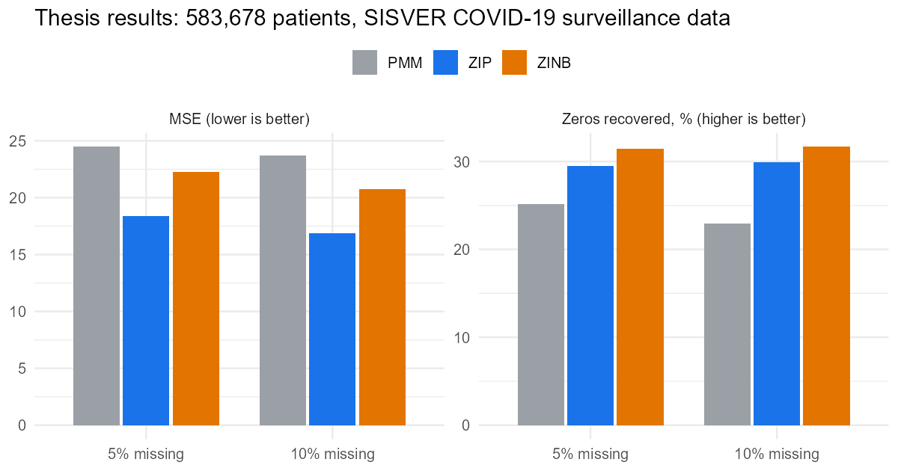
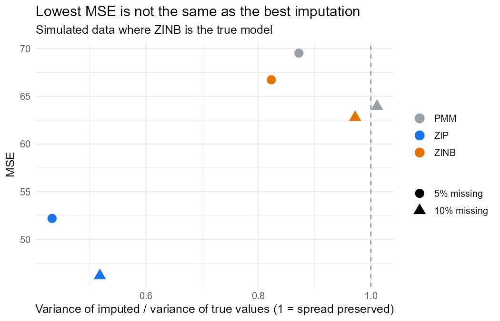

# Multiple imputation of zero-inflated counts with MICE

**Can count models (ZIP/ZINB) beat Predictive Mean Matching when the variable to impute has a large excess of zeros?**

Code and results from my BSc thesis in Mathematics at UNAM (2025), *"Métodos de Estimación e Imputación de Variables Cero Infladas con el Modelo de Imputación Multivariada por Ecuaciones Encadenadas"*, supervised by Dr. Ruth Selene Fuentes García.

📄 [Thesis (TESIUNAM)](LINK_PENDIENTE) · 📊 [Project report](https://amaugomez.github.io/mice-zero-inflated/)

---

## The problem

In Mexico's COVID-19 surveillance system (SISVER, Jan–Jun 2020: **583,678 patients, 113 variables**), the variable *days with symptoms before admission* has an unusual number of zeros. Many are **structural zeros**: when a severely ill patient arrived and the onset date could not be obtained, clinicians recorded the admission date as the onset date.

Standard imputation (PMM) ignores this mechanism. The hypothesis: zero-inflated imputation models (ZIP, ZINB) should recover the missing values better.

## Approach

1. **Model diagnosis.** Fitted Poisson → negative binomial → ZIP → ZINB, comparing dispersion ratios, predicted vs observed zeros and information criteria. The outcome was both overdispersed and zero-inflated.
2. **Covariate imputation.** Imputed the missing values in the other covariates with MICE, using a hand-built predictor matrix.
3. **Masking experiment.** Hid 5% and 10% of the known outcome values completely at random, imputed them with **PMM, ZIP and ZINB** inside MICE, and compared the imputed values with the hidden true values.

## Results (original data)



| 10% missing | PMM | ZIP | ZINB |
|---|---|---|---|
| MSE | 23.68 | **16.86** | 20.74 |
| MAE | 3.46 | **2.94** | 3.24 |
| Zeros recovered | 22.9% | 29.9% | **31.7%** |
| Imputation time (m = 10) | **1 h 36 min** | 8 h 21 min | 10 h 45 min |

- **ZIP reduced MSE by 29% compared with PMM.**
- **ZINB recovered 38% more structural zeros than PMM.**
- **The cost:** the count models were 5–7 times slower.

Full table: [`results/thesis/imputation_results_thesis.csv`](results/thesis/imputation_results_thesis.csv)

## A second look: lowest MSE ≠ best imputation

In the thesis, ZIP had the lowest MSE even though ZINB fitted the data better, which looked unexpected. The simulation in this repo, where **ZINB is the true model**, reproduces the same pattern and explains it:



**Why it happens:**
- An imputation is a *random draw*, not a point prediction.
- Poisson draws vary less than negative binomial draws, so ZIP gets a lower MSE.
- The price is that ZIP imputations keep only ~50% of the real variance, so the imputed data are **too narrow**. That would make standard errors and confidence intervals too small in any analysis that uses them.
- ZINB and PMM keep the spread of the real distribution (variance ratio ≈ 0.8–1.0).

**The lesson:** imputation methods should be judged by whether they preserve the distribution and give valid inference, not only by point-error metrics.

## Reproduce it

The SISVER data are **not public**, so this repo runs the same pipeline on a **simulated cohort** with the same structure: binary symptoms and comorbidities, age, severity markers, and a zero-inflated, overdispersed outcome whose zeros depend on severity.

```r
# R >= 4.3
Rscript run_all.R   # about 3 minutes
```

| Script | What it does |
|---|---|
| `R/01_simulate_data.R` | Synthetic cohort (20,000 patients) mimicking the SISVER structure |
| `R/02_count_models.R` | Poisson / NB / ZIP / ZINB diagnosis: dispersion, predicted zeros, AIC |
| `R/03_imputation_methods.R` | Custom MICE methods `zip_boot` and `zinb_boot` (bootstrap + `pscl::zeroinfl`) |
| `R/04_run_experiment.R` | Masking experiment, scored over all *m* imputations |
| `R/05_figures.R` | Figures |

**Note on methods:** the thesis used the `countimp` package. `03_imputation_methods.R` is a small reimplementation of the same approach, so the demo runs on current R without unmaintained dependencies: bootstrap the observed cases, fit a zero-inflated model, then draw a structural-zero indicator and a count.

## Skills shown

Multiple imputation (MICE) · count and zero-inflated models (Poisson, NB, ZIP, ZINB) · model diagnostics · simulation studies · writing custom `mice` methods · R

---

Aaron Mauricio Gómez Jiménez · [LinkedIn](https://www.linkedin.com/in/amaugomezjimenez) · maugomez@ciencias.unam.mx
