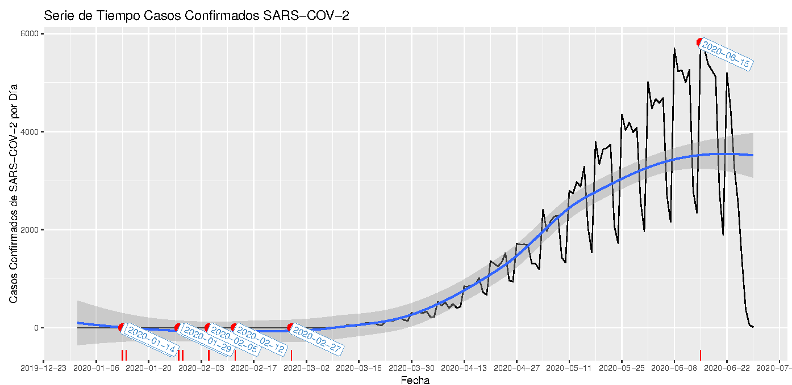
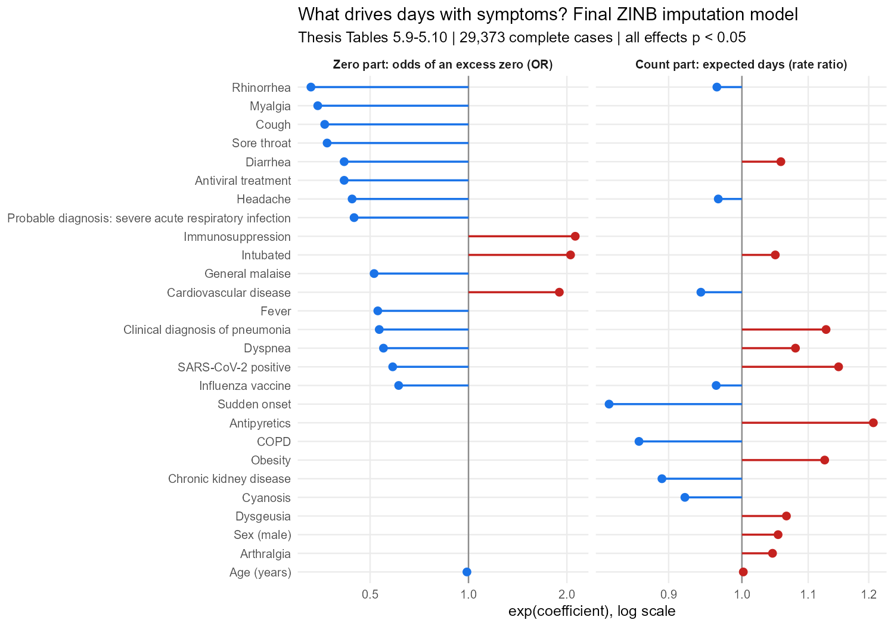

Tesis de Licenciatura en Matemáticas, Facultad de Ciencias, UNAM · 150 páginas.
Directora: Dra. Ruth Selene Fuentes García.
[Tesis (TESIUNAM)](https://tesiunamdocumentos.dgb.unam.mx/ptd2025/abr_jun/0872591/Index.html) · [Código en GitHub](https://github.com/AMauGomez/mice-zero-inflated) · 🇬🇧 [Full report in English](index.html)

## Resumen

**Pregunta.** En una base nacional de salud, la variable que necesitamos tiene muchos más ceros de los que permite cualquier distribución de conteo, y además faltan datos en otras variables. ¿Los modelos de imputación diseñados para exceso de ceros (ZIP, ZINB) superan al método estándar, Predictive Mean Matching (PMM), dentro de MICE?

**Enfoque.** Una imputación múltiple **multivariada**: **42 de las 44 variables** tenían datos faltantes y todas se imputaron juntas con MICE. La evaluación se concentra en la más difícil, los días con síntomas, donde se compararon tres métodos contra los valores verdaderos.

**Respuesta.** Sí en precisión, con un costo computacional alto:

- **ZIP redujo el error cuadrático medio 29%** respecto a PMM.
- **ZINB recuperó 38% más ceros verdaderos** que PMM y fue el modelo con mejor ajuste.
- Ambos tardaron **entre 5 y 7 veces más**: hasta 10 h 45 min por corrida en una laptop.
- Un análisis posterior (2026) de las imputaciones guardadas muestra que el MSE bajo de ZIP viene de imputaciones **demasiado estrechas**: conservan cerca de la mitad de la varianza real.

## El problema

La variable de interés son los **días con síntomas antes del ingreso** (fecha de ingreso menos fecha de inicio de síntomas) en el sistema de vigilancia epidemiológica de enfermedad respiratoria viral (SISVER), enero a junio de 2020. Sus ceros vienen de dos fuentes que no se pueden distinguir:

- **Ceros reales:** pacientes asintomáticos o que ingresaron el mismo día en que empezaron los síntomas.
- **Datos faltantes disfrazados:** cuando el paciente llegaba demasiado grave para responder, la fecha de inicio se llenaba con la de ingreso.

Por eso se usó un **modelo de mezcla** (cero inflado) y no un modelo hurdle: en el hurdle todos los ceros salen de un solo proceso; en la mezcla un cero puede venir de cualquiera de las dos fuentes, que es justo lo que pasa en estos datos.

## Cómo se hizo

1. **Preparación:** 113 → 61 → 44 variables; "SE IGNORA" y resultados de laboratorio inválidos recodificados como faltantes (1.65 millones de datos faltantes).
2. **Distribución:** media 3.68, varianza 10.91, 15.9% de ceros; las pruebas χ² rechazan Poisson y binomial negativa.
3. **Modelos:** logística, Poisson, binomial negativa, ZIP y ZINB con selección stepwise por AIC, validación cruzada de 10 folds, pruebas de sobredispersión y de exceso de ceros (DHARMa). ZINB fue el único que corrigió la dispersión (1.00) y los ceros (1.04).
4. **MICE multivariado:** las 41 covariables incompletas (síntomas, comorbilidades, tratamientos, intubación, resultado de laboratorio) imputadas con PMM (m = 10, 12 iteraciones); 5% y 10% de los días con síntomas ocultos al azar e imputados con PMM, ZIP y ZINB (`countimp`), con matrices de predicción hechas a mano que separan la parte de conteo y la parte de ceros.
5. **Convergencia:** gráficas de traza de la media y la desviación estándar en cada método y escenario.

## Resultados (10% de datos ocultos)

| | PMM | ZIP | ZINB |
|---|---|---|---|
| MSE | 23.68 | **16.86** | 20.74 |
| MAE | 3.46 | **2.94** | 3.24 |
| Ceros recuperados | 22.9% | 29.9% | **31.7%** |
| Varianza imputada / real | 1.01 | 0.53 | 0.85 |
| Tiempo de imputación | **1 h 36 min** | 8 h 21 min | 10 h 45 min |

**Conclusión:** para imputar una variable cero inflada conviene usar métodos especializados. ZINB ofrece el mejor equilibrio: recupera más ceros y conserva la mayor parte de la dispersión real. Un método no debe elegirse solo por el MSE.

## Dónde se aplica

Cualquier variable de conteo con exceso de ceros y datos faltantes: días de estancia hospitalaria, visitas a urgencias, número de reclamaciones de seguros, pagos atrasados, días de trabajo perdidos en encuestas como la ENSANUT.

---

**Sinodales:** Dra. Lizbeth Naranjo Albarrán, Ph.D. José Antonio Perusquía Cortés, Dr. Alan Riva Palacio Cohen, Dra. María Fernanda Gil Leyva Villa. Directora: Dra. Ruth Selene Fuentes García.
