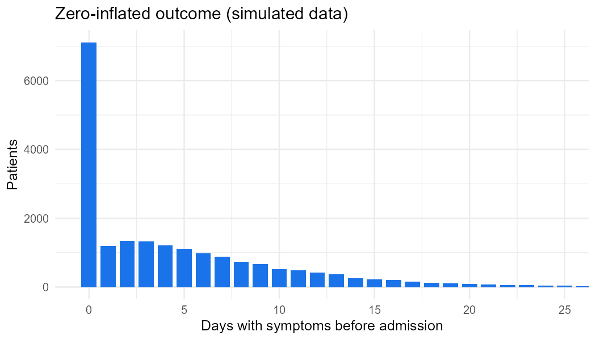

```{r}
#| include: false
library(readr); library(dplyr); library(knitr)
thesis <- read_csv("results/thesis/imputation_results_thesis.csv", show_col_types = FALSE)
demo   <- read_csv("results/demo/imputation_metrics.csv", show_col_types = FALSE)
models <- read_csv("results/demo/count_model_comparison.csv", show_col_types = FALSE)
```

## Summary

- **The data:** Mexico's COVID-19 surveillance system (SISVER), January–June 2020: **583,678 patients and 113 variables**.
- **The variable to impute:** *days with symptoms before admission*. It is overdispersed and has an excess of **structural zeros**, recorded when the onset date of severely ill patients could not be obtained.
- **The comparison:** three MICE imputation methods (PMM, ZIP and ZINB), tested by hiding 5% and 10% of known values and checking the imputations against the truth.

**Main findings:**

- On the real data, **ZIP gave the lowest error (−29% MSE vs PMM)**.
- **ZINB recovered the most structural zeros (+38% vs PMM).**
- **Both count models took 5–7 times longer** to impute.
- A simulation study shows that ZIP's lower MSE comes from **imputations that are too narrow**. Lowest MSE is not the same as the best imputation.

## 1. Why a zero-inflated model?

```{r}
#| fig-cap: "Simulated outcome with the same structure as the real one."

```

The thesis checked the count models in sequence. Here is the same check on the simulated cohort:

```{r}
kable(models, col.names = c("Model", "AIC", "Dispersion ratio", "Predicted zeros",
                            "Observed zeros", "Predicted / observed zeros"))
```

**How to read it:**
- **Poisson** badly underpredicts zeros and is overdispersed.
- **Negative binomial** fixes the dispersion but still misses zeros.
- **ZIP** gets the zeros right but stays overdispersed.
- **ZINB** fixes both. Same pattern as in the original data.

## 2. Results on the original data

```{r}
include_graphics("figures/thesis_results.png")
thesis |>
  select(method, missing_pct, m, MSE, RMSE, MAE, zeros_recovered_pct, imputation_time) |>
  kable(col.names = c("Method", "% missing", "m", "MSE", "RMSE", "MAE",
                      "Zeros recovered (%)", "Time"))
```

## 3. Simulation: why ZIP wins on MSE

An imputation is a **random draw** from a predictive distribution. Its MSE against the truth is

$$
\text{MSE} = \underbrace{(\text{bias})^2}_{\text{model}} + \operatorname{Var}(Y) + \operatorname{Var}(\tilde Y),
$$

so a method whose draws vary **less** scores better, even when its model is wrong. In the simulation the true model is ZINB:

```{r}
include_graphics("figures/mse_vs_variance.png")
demo |>
  select(missing_pct, method, MSE, MAE, zeros_recovered_pct, variance_ratio, seconds) |>
  kable(digits = 2, col.names = c("% missing", "Method", "MSE", "MAE",
                                  "Zeros recovered (%)", "Variance ratio", "Seconds"))
```

**What the simulation shows:**
- ZIP's imputations keep only about **half of the real variance**. Analyses that use them would report standard errors and confidence intervals that are too small.
- ZINB and PMM keep the spread.

**Conclusion:** choose imputation models for **distributional fidelity and valid inference** (Rubin's rules), not only for point error.

## 4. Implementation

The thesis used `countimp`. The demo uses a small reimplementation with the same logic: bootstrap the observed cases, fit `pscl::zeroinfl`, then draw a structural-zero indicator and a count.

```{r}
#| echo: false
#| class-output: r
cat(readLines("R/03_imputation_methods.R"), sep = "\n")
```

Full code: [github.com/AMauGomez/mice-zero-inflated](https://github.com/AMauGomez/mice-zero-inflated)

## Limitations

- **The masking was MCAR.** Real missingness in surveillance data is probably MAR or MNAR (sicker patients have less complete records).
- **The thesis scored the first completed dataset.** The demo averages over all *m* imputations.
- **The simulated data reproduce the structure of the real data, not its exact values.** Demo numbers are not comparable with the thesis numbers.
