```{r}
#| include: false
library(readr); library(dplyr); library(knitr)
thesis <- read_csv("results/thesis/imputation_results_thesis.csv", show_col_types = FALSE)
spread <- read_csv("results/thesis/real_data_distribution_check.csv", show_col_types = FALSE)
cm     <- read_csv("results/thesis/count_models_thesis.csv", show_col_types = FALSE)
zi     <- read_csv("results/thesis/zi_models_thesis.csv", show_col_types = FALSE)
demo   <- read_csv("results/demo/imputation_metrics.csv", show_col_types = FALSE)
```

BSc thesis in Mathematics (*Matemático*), Facultad de Ciencias, UNAM · defended 8 August 2025 · 150 pages.
Supervisor: Dra. Ruth Selene Fuentes García.
[Thesis (TESIUNAM)](https://tesiunamdocumentos.dgb.unam.mx/ptd2025/abr_jun/0872591/Index.html) · [Code on GitHub](https://github.com/AMauGomez/mice-zero-inflated) · [Original analysis scripts](https://github.com/AMauGomez/mice-zero-inflated/tree/main/thesis_code) · 🇲🇽 [Leer en español](es.html)

```{=html}
<style>
.flow{display:flex;flex-wrap:wrap;gap:.6rem;margin:1.2rem 0 .4rem;align-items:stretch}
.flow .step{flex:1 1 150px;border:1px solid #dadce0;border-radius:10px;padding:.75rem .8rem;background:#fafbfc}
.flow .step .n{font-size:.72rem;letter-spacing:.06em;text-transform:uppercase;color:#5f6368}
.flow .step .big{font-size:1.35rem;font-weight:700;line-height:1.15;margin:.2rem 0}
.flow .step .txt{font-size:.85rem;color:#3c4043;line-height:1.3}
.flow .arrow{align-self:center;color:#9aa0a6;font-size:1.3rem}
.flow .step.hl{border-color:#1a73e8;background:#e8f0fe}
@media (max-width:700px){.flow .arrow{display:none}}
</style>
<div class="flow">
 <div class="step"><div class="n">1 · Data</div><div class="big">583,678</div><div class="txt">COVID-19 patients; 42 of 44 variables incomplete (1.65 M missing values), all imputed with MICE</div></div>
 <div class="arrow">→</div>
 <div class="step"><div class="n">2 · Problem</div><div class="big">15.9% zeros</div><div class="txt">from two sources: real same-day cases and copied dates</div></div>
 <div class="arrow">→</div>
 <div class="step"><div class="n">3 · Model</div><div class="big">ZIP · ZINB</div><div class="txt">mixture models built with stepwise AIC, 10-fold CV, DHARMa</div></div>
 <div class="arrow">→</div>
 <div class="step"><div class="n">4 · Experiment</div><div class="big">~28 h</div><div class="txt">of MICE runs: PMM vs ZIP vs ZINB on ~87,000 hidden values</div></div>
 <div class="arrow">→</div>
 <div class="step hl"><div class="n">5 · Result</div><div class="big">−29% · +38%</div><div class="txt">MSE (ZIP) and zeros recovered (ZINB) vs PMM; but ZIP keeps only half the variance</div></div>
</div>
```

## Summary

**Question.** In a national health database, the variable we need has far more zeros than any count distribution allows, and other variables are missing too. Do imputation models built for excess zeros (ZIP, ZINB) beat the default, Predictive Mean Matching (PMM), inside MICE?

**Approach.** A full **multivariate** multiple imputation: **42 of the 44 variables** had missing values and all of them were imputed together with MICE. The evaluation then focuses on the hardest one, days with symptoms, where three methods were compared against known true values.

**Answer.** Yes on accuracy, at a high computational price:

- **ZIP cut the mean squared error by 29%** compared with PMM.
- **ZINB recovered 38% more of the true zeros** than PMM, and was the best-fitting model.
- Both took **5–7 times longer**: up to 10 h 45 min for a single run on a laptop.
- A later look at the saved imputations adds a twist: ZIP's low error comes from imputations that are **too narrow**. The lowest MSE is not the best imputation.

| By the numbers | |
|---|---|
| Patients | **583,678** (SISVER, January–June 2020) |
| Variables | 113 raw → **44** in the imputation model, **42 of them imputed** |
| Values masked and re-imputed | **~29,000 and ~58,000** (5% and 10%) |
| Candidate models built and tested | Logistic, Poisson, NB, ZIP, ZINB (stepwise AIC, 10-fold CV, DHARMa) |
| MICE runs | 1 covariate run (m = 10) + 6 outcome runs (3 methods × 2 scenarios) |
| Computing time | **~28 hours** of imputation on a laptop (Core i5, 16 GB RAM) |

## 1. Why this problem matters

In the first months of COVID-19, Mexico's respiratory-disease surveillance system (SISVER) recorded every suspected case: symptoms, comorbidities, treatment, lab result and dates. Hospitals were overwhelmed and the records show it: many questionnaires were incomplete.

```{r}
#| fig-cap: "Daily confirmed cases in the study database; peak on 15 June 2020 (thesis figure 5.3)."
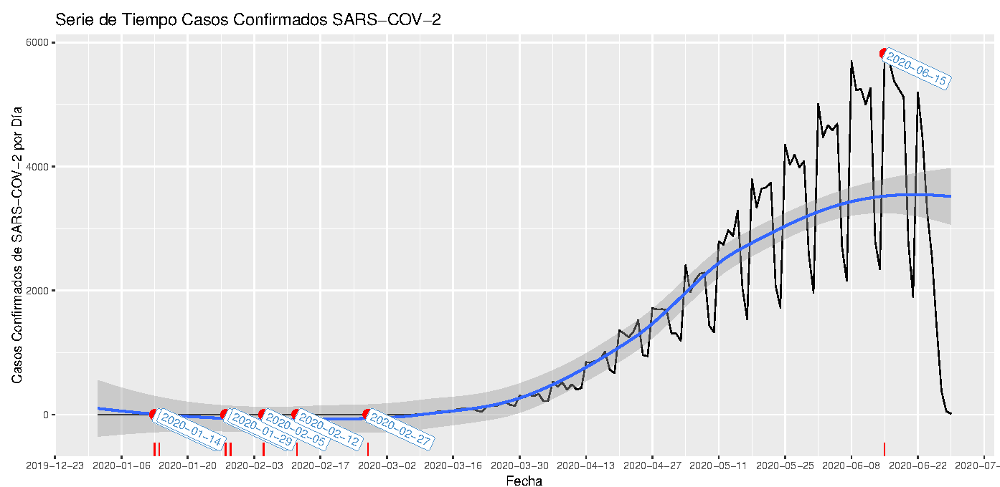
```

The variable of interest is **days with symptoms before admission**: admission date minus symptom-onset date. It measures how long patients waited before reaching a hospital, a basic quantity for describing a disease and the response to it. It is also the variable where record quality was worst:

- Some zeros are **real**: asymptomatic confirmed patients, or patients admitted the day symptoms started.
- Many zeros are **missing values in disguise**: when a patient arrived too ill to answer, the onset date was often filled in with the admission date.

The two cannot be told apart in the data. Deleting incomplete records or imputing with a generic method risks biasing every analysis built on this variable. The same situation appears in any registry with a count outcome.

::: {.callout-tip}
## Where this applies

The method carries over to any count variable with excess zeros and gaps:

- **Health and real-world evidence:** days in hospital, number of emergency visits or hospitalisations, adverse events per patient, days to treatment start.
- **Insurance:** number of claims per policy, where most policyholders file none.
- **Credit risk:** missed payments per customer.
- **Public surveys:** days of work lost, doctor visits (ENSANUT-type questionnaires).
:::

## 2. The data

- **583,678 patients, 113 variables**: demographics, 30+ symptoms, comorbidities, treatments, SARS-CoV-2 result, dates.
- **Selection:** dropped variables that did not apply to every patient (pregnancy, travel, death dates, hospital coordinates), leaving 61; converted yes/no items to binary, leaving **44 numeric variables**.
- **Recoding:** "unknown" answers and unusable lab results (rejected, not received, did not amplify…) were set to missing so MICE could impute them.
- **Missingness:** 1.65 million missing cells before any masking, concentrated in a few variables.

```{r}
#| fig-cap: "Share of patients reporting each symptom, comorbidity or treatment (thesis figure 5.6)."
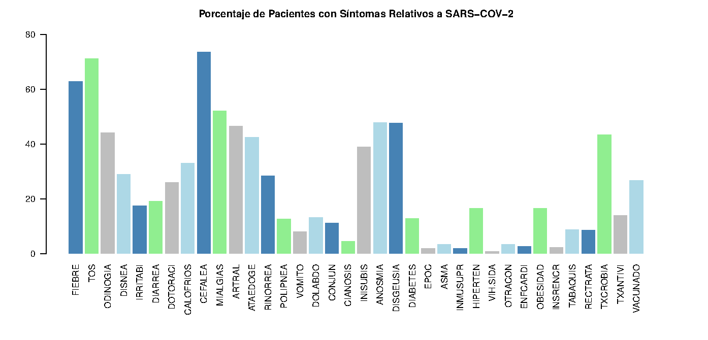
```

```{r}
#| fig-cap: "Missing-data pattern, variables 31–61: each black line is a patient with a missing value. Anosmia and dysgeusia (42%), antimicrobial treatment (29%) and lab result (14%) have the most gaps; intubation status, not shown, is missing for 78% (thesis figure 5.2)."
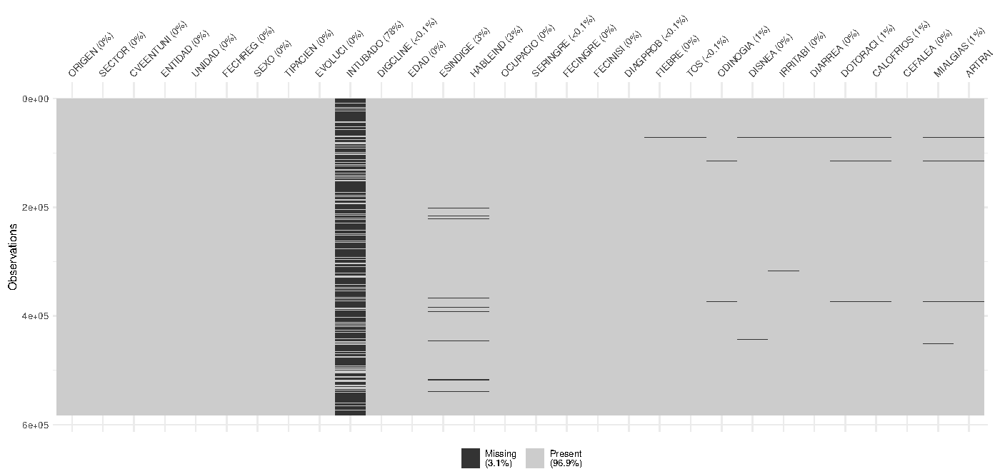
```

## 3. The variable to impute

```{r}
#| fig-cap: "Days with symptoms, all 583,678 patients (thesis figure 5.7)."
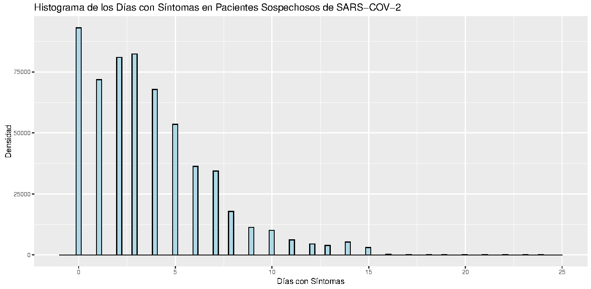
```

| N | Mean | Variance | SD | Zeros |
|---|---|---|---|---|
| 583,678 | 3.68 | 10.91 | 3.30 | 15.9% |

- The **variance is three times the mean**, so a Poisson model is ruled out.
- **Chi-square goodness-of-fit tests reject** both the Poisson (λ = 3.68) and the negative binomial (size = 1.80) distributions (p < 0.001).
- The negative binomial adds zeros but still misses the shape of the distribution:

```{r}
#| fig-cap: "Empirical (black), Poisson (orange) and negative binomial (blue) distributions (thesis figure 5.8)."
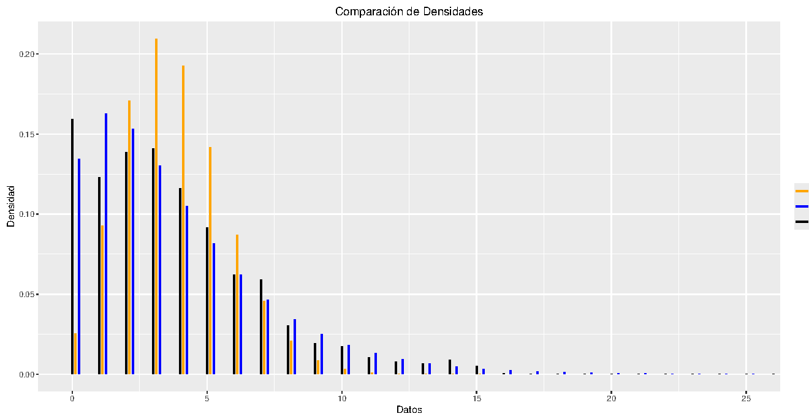
```

## 4. Why a zero-inflated mixture model

A **zero-inflated model** is a mixture of two processes. With probability π a patient belongs to a class that always records 0; otherwise the count comes from a Poisson (ZIP) or negative binomial (ZINB) distribution:

$$
P(Y = 0) = \pi + (1-\pi)\,f(0), \qquad P(Y = y) = (1-\pi)\,f(y), \quad y > 0.
$$

Each part has its own regression: a **logit for π** (who is an excess zero?) and a **log link for the mean** (how many days?), with different predictors allowed in each part.

**Zero-inflated Poisson (ZIP).** The count part is Poisson with mean λ:

$$
P(Y = 0) = \pi + (1-\pi)e^{-\lambda}, \qquad P(Y = y) = (1-\pi)\,\frac{e^{-\lambda}\lambda^{y}}{y!}, \quad y > 0,
$$

$$
E(Y) = (1-\pi)\lambda, \qquad \operatorname{Var}(Y) = (1-\pi)\lambda\,(1 + \pi\lambda).
$$

The variance exceeds the mean as soon as π > 0, so the extra zeros alone explain part of the **overdispersion**. With π → 0 it reduces to the Poisson.

**Zero-inflated negative binomial (ZINB).** The count part is negative binomial with mean μ and dispersion α:

$$
P(Y = 0) = \pi + (1-\pi)\left(\frac{1}{1+\alpha\mu}\right)^{1/\alpha}, \qquad
P(Y = y) = (1-\pi)\,\frac{\Gamma(y + 1/\alpha)}{\Gamma(y+1)\,\Gamma(1/\alpha)}
\left(\frac{1}{1+\alpha\mu}\right)^{1/\alpha}\left(\frac{\alpha\mu}{1+\alpha\mu}\right)^{y},
$$

$$
E(Y) = (1-\pi)\mu, \qquad \operatorname{Var}(Y) = (1-\pi)\mu\,\big(1 + \mu(\pi + \alpha)\big).
$$

The extra parameter α absorbs the overdispersion that remains once the zeros are accounted for. With α → 0 it reduces to the ZIP.

Both models are fitted by maximum likelihood; the thesis derives the likelihood equations and notes they can be solved with the EM algorithm. Section 5 shows which one the data support: ZIP fixes the zeros but stays overdispersed; ZINB fixes both.

**Why a mixture and not a hurdle model?** A hurdle model splits the data into "zero" and "positive": *every* zero comes from one binary process, and the count part is truncated so it can never produce a zero. That fits data where zeros mean something different from positives. Here they do not: a patient admitted on the day symptoms began is a genuine count of 0, while a copied admission date is an artefact. Only the mixture lets a zero come from **either** source, which is exactly the situation in SISVER. The zero part then estimates, patient by patient, the probability of belonging to the excess-zero class, and the imputation draws from both sources accordingly.

## 5. Building the imputation model

The imputation model for days with symptoms was built as a regression model first, using the 29,373 patients with complete records:

1. **Candidate predictors** from correlograms, principal component analysis and subject-matter knowledge.
2. **Zero part:** logistic regression for "zero days", with stepwise selection by AIC.
3. **Count part:** Poisson and negative binomial regressions, stepwise by AIC; multicollinearity, residual and deviance checks; **10-fold cross-validation**.
4. **Mixture models:** the two parts combined into ZIP and ZINB and refined with the PCA and the significance of each term.
5. **Diagnostics for every model:** overdispersion tests (`AER`, `performance`), zero-inflation and dispersion tests on simulated quantile residuals (`DHARMa`), and the ratio of predicted to observed zeros.

```{r}
cm |>
  select(model, n_variables, RMSE_cv10, dispersion_ratio, zeros_predicted, zeros_observed, zero_ratio) |>
  kable(col.names = c("Model", "Variables", "CV RMSE (10-fold)", "Dispersion ratio",
                      "Predicted zeros", "Observed zeros", "Predicted / observed"))
```

- **Poisson** is overdispersed (2.14) and predicts barely a quarter of the zeros.
- **Negative binomial** fixes the dispersion but still misses a quarter of the zeros.
- **ZIP** gets the zeros right (0.98) but stays overdispersed (1.68).
- **ZINB fixes both** (1.00 and 1.04) with fewer predictors in its zero part, and has the lowest AIC (138,850 vs 145,003 for ZIP). It is the most robust model.

### The final model

```{r}
#| fig-cap: "Final ZINB model (thesis Tables 5.9–5.10). Left: effects on the odds of an excess zero. Right: effects on the expected number of days."
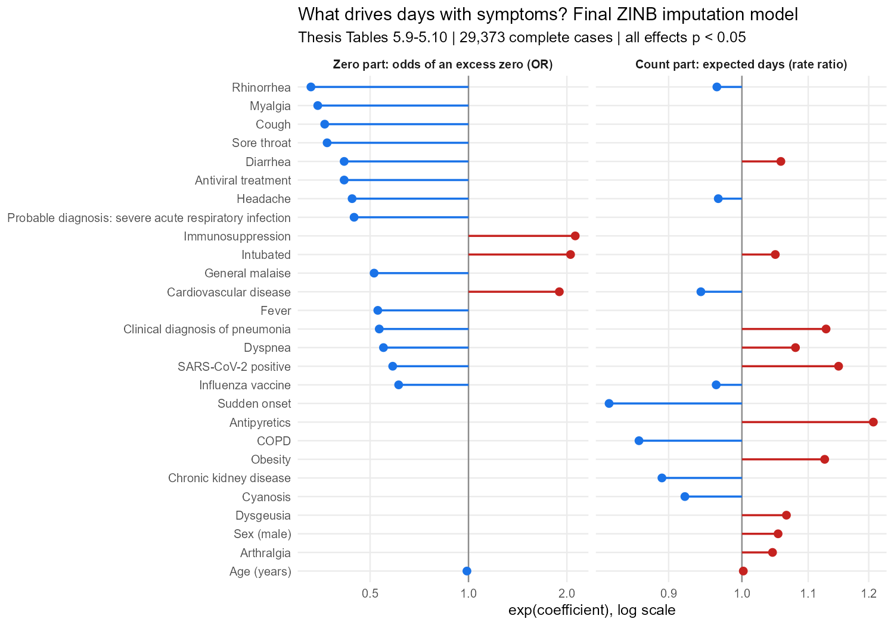
```

**How to read it:**

- **Zero part.** Patients who were **intubated**, **immunosuppressed** or had **cardiovascular disease** were about twice as likely to have a zero, consistent with critically ill patients whose onset date could not be recorded. Patients who **reported symptoms** (cough, myalgia, rhinorrhea, sore throat…) were much less likely to have one.
- **Count part.** **Sudden onset** shortened the delay to admission by about 17%; **antipyretic use**, a **positive SARS-CoV-2 test** and **obesity** lengthened it by 12–21%.

```{r}
mark <- function(x) ifelse(is.na(x), "", "●")
zi |>
  filter(variable != "CONSTANTE") |>
  transmute(Variable = label, `Code` = variable,
            `ZIP count` = mark(zip_count), `ZIP zero` = mark(zip_zero),
            `ZINB count` = mark(zinb_count), `ZINB zero` = mark(zinb_zero)) |>
  kable(caption = "Variables in each part of the final ZIP and ZINB models", align = "llcccc")
```

## 6. How MICE works: from EM to Gibbs sampling

Multiple imputation replaces each missing value with **m plausible values**, so the uncertainty about what is missing carries into every later analysis. The thesis builds up to MICE in three steps.

**Missing-data mechanisms.** Data can be missing completely at random (MCAR), at random given the observed data (MAR), or not at random (MNAR). Under MCAR or MAR the mechanism is *ignorable*: valid inference only needs a model for the data, not for why values are missing. MICE assumes MAR.

**The EM algorithm.** Dempster, Laird and Rubin's EM algorithm handles missing data by alternating two steps until the estimates converge:

- **E-step:** replace the missing part of the log-likelihood with its conditional expectation given the observed data and the current parameters.
- **M-step:** maximise that expected log-likelihood to update the parameters.

EM gives maximum-likelihood **estimates**, not completed datasets. It also connects to section 4: the ZIP likelihood equations can be solved with EM, treating the unknown "excess zero or not" label as missing data.

**Gibbs sampling (MCMC).** When a joint distribution is too hard to sample directly, a Gibbs sampler draws each variable in turn from its **full conditional** distribution:

$$
X_1^{(t+1)} \sim f_1\big(x_1 \mid x_2^{(t)}, \dots, x_p^{(t)}\big), \;\; \dots, \;\; X_p^{(t+1)} \sim f_p\big(x_p \mid x_1^{(t+1)}, \dots, x_{p-1}^{(t+1)}\big).
$$

This builds a Markov chain whose stationary distribution is the joint distribution. By the ergodic theorems the chain converges to it when it is **irreducible, aperiodic and recurrent**.

**MICE is a Gibbs sampler for missing data.** Van Buuren and Groothuis-Oudshoorn's MICE specifies one conditional imputation model per incomplete variable, which is how PMM, ZIP and ZINB can live in the same model. At iteration *t*, for each variable *j*:

$$
\theta_j^{(t)} \sim f\big(\theta_j \mid Y_j^{obs}, Y_{-j}^{(t)}\big), \qquad
Y_j^{mis\,(t)} \sim f\big(Y_j \mid Y_j^{obs}, Y_{-j}^{(t)}, \theta_j^{(t)}\big).
$$

- **First draw the parameters, then the values.** This is what makes imputation *proper*: the parameter uncertainty enters the imputations. `countimp` does exactly this, drawing the ZIP/ZINB coefficients from their approximate posterior before drawing each value.
- **m chains run in parallel**, one per imputed dataset, each started from random draws of the observed values.
- **Compatibility.** The conditional models need not come from any real joint distribution. When they are incompatible, the chain can still run but may produce artificial modes, so the specification of each conditional model matters (section 5).
- **Convergence in practice.** Recurrence is the condition that can fail, mostly with deterministic imputation models. Trace plots of the mean and SD of the imputed values across iterations are the standard check (section 8).

**Combining results.** The m completed datasets are analysed separately and combined with Rubin's rules: the total variance adds the within-imputation variance and (1 + 1/m) times the between-imputation variance.

## 7. MICE design

The imputation is **multivariate**: every incomplete variable gets its own conditional model inside the same MICE run, and each imputed variable helps predict the others. Of the 44 variables, only sex and age were complete; the other 42 were imputed. The study then zooms in on one of them, days with symptoms, because it is the variable whose excess zeros make the choice of method matter.

**Step 1 — the 41 other incomplete variables.** Symptoms, comorbidities, treatments, intubation and lab result were imputed with PMM, which works well for binary variables and only imputes values that were actually observed.

- Predictors for each variable chosen from the correlogram, the PCA and the literature.
- m = 10 imputations and 12 iterations. Intubation (78% missing) would need m ≈ 80 by the usual rule, which was computationally out of reach; the next variables had 42%, 42%, 29% and 14% missing.
- Run time 2 h 34 min; missingness fell to 0.31%.

**Step 2 — the variable of interest.** 5% and 10% of the observed values of days with symptoms were hidden by simple random sampling and kept aside as the truth. They were imputed with **PMM** (`mice`) and with **ZIP** and **ZINB** (`countimp`), with m = iterations = 5 for 5% and 10 for 10%. The remaining 0.31% of covariate gaps were imputed in the same run, so every run was still a joint, multivariate imputation.

The predictor matrix carries the model-building results into MICE: for days with symptoms, code **2** puts a predictor in the count part only and code **3** in the zero part only.

```{r}
#| fig-cap: "The hand-built predictor matrix used in the ZIP run (thesis_code/predictor_matrices/)."
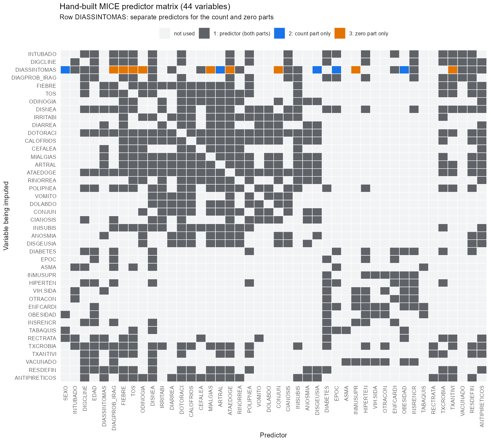
```

## 8. Convergence

Trace plots of the mean and standard deviation of the imputed values were checked for every variable, method and scenario. The chains mix and stay in a narrow band, with no trend:

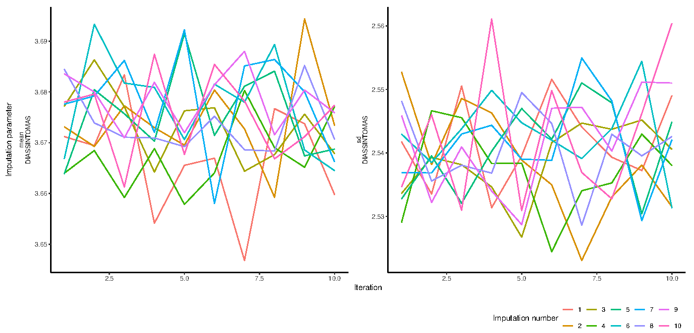

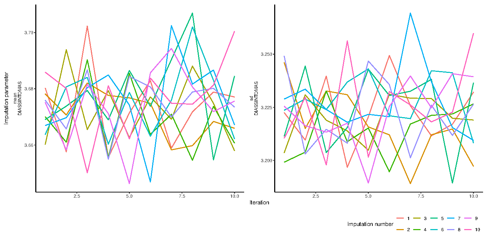

Imputed (red) vs observed (blue) distributions, 10% missing:

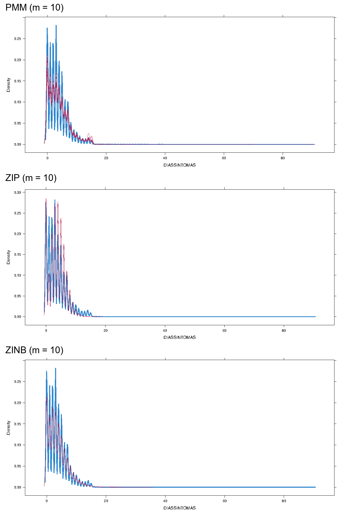

## 9. Results

```{r}
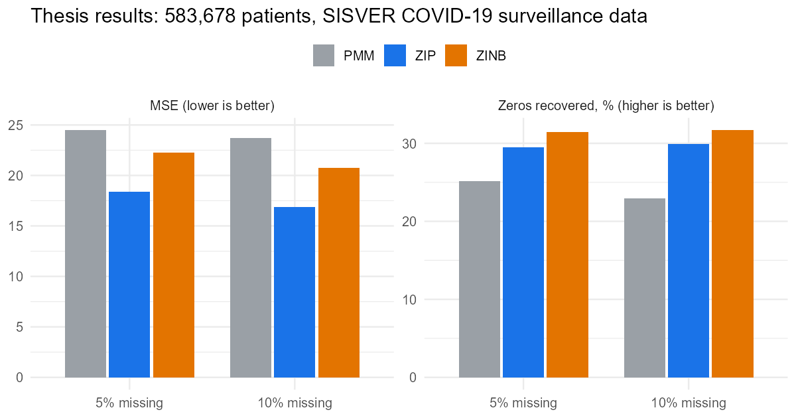
thesis |>
  select(method, missing_pct, MSE, RMSE, MAE, exact_match_pct, zeros_recovered_pct,
         nonzero_exact_pct) |>
  kable(col.names = c("Method", "% masked", "MSE", "RMSE", "MAE", "Exact matches (%)",
                      "Zeros recovered (%)", "Non-zeros exact (%)"))
```

- **ZIP:** lowest MSE, RMSE and MAE in both scenarios, and the most exact matches among non-zero values.
- **ZINB:** best at recovering zeros in both scenarios.
- **PMM:** least accurate. A sensible first pass, not a final answer, when the variable is zero-inflated.

**Computational cost** (Intel Core i5-1135G7, 16 GB RAM):

| Method | 5% masked (m = 5) | 10% masked (m = 10) | 15% masked (projected) |
|---|---|---|---|
| PMM | 27 min | 1 h 36 min | 3 h 36 min |
| ZIP | 2 h 4 min | 8 h 21 min | 18 h 45 min |
| ZINB | 2 h 43 min | 10 h 45 min | 24 h 27 min |

Run time grows much faster than the amount of missing data. At 15%, the count models would need about a day per run: they pay off when precision matters, as in this data, but they are not free.

## 10. Revisiting the result (2026)

*This section goes beyond the thesis. It uses the imputations saved during the thesis.*

ZINB fitted the data best (section 5), yet ZIP had the lowest MSE. The reason is what an imputation is: a **random draw** from a predictive distribution, not a best guess. Its expected squared error against the truth is

$$
E\big[(Y - \tilde Y)^2\big] = (E\,Y - E\,\tilde Y)^2 + \operatorname{Var}(Y) + \operatorname{Var}(\tilde Y),
$$

so a method whose draws vary **less** scores better, even when its model is worse. The saved imputations confirm it:

```{r}
spread |>
  select(method, missing_pct, MSE, variance_ratio, max_imputed, max_true) |>
  kable(col.names = c("Method", "% masked", "MSE", "Var(imputed) / Var(true)",
                      "Largest imputed", "Largest true"))
```

```{r}
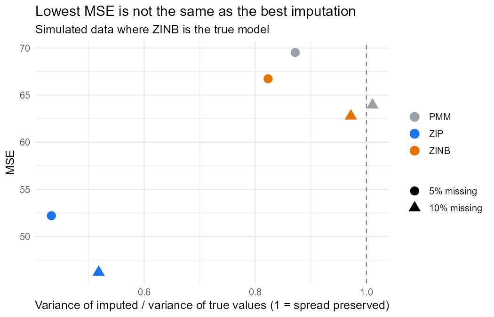
```

- **ZIP** keeps only about **half of the real variance** and never imputes more than 18 days, while true values reach 115. An analysis run on those data would report standard errors that are too small.
- **ZINB** and **PMM** keep most of the spread.
- A simulation where ZINB is the true model (right panel) reproduces the pattern.

**Takeaway:** judge an imputation method by whether it preserves the distribution and supports valid inference, not by point-error metrics alone. By that standard, ZINB, the best-fitting model, offers the best balance of the three: the most zeros recovered, the second-lowest error and most of the real spread.

## What this means in practice

A decision guide for imputing a count variable with excess zeros, from the thesis results and the revisited analysis:

| Situation | Recommendation |
|---|---|
| First pass, large data, little time | **PMM.** Fast (4–7× quicker here) and only imputes observed values, but the least accurate. |
| Zeros matter (prevalence, "no event" rates) | **ZINB.** Recovered the most zeros while keeping most of the real spread. |
| Overdispersion persists after modelling the zeros | **ZINB** over ZIP: the dispersion parameter is what fixes it. |
| Choosing between methods | Compare the **variance and range** of the imputations with the observed data, not only the MSE. |
| Building the imputation model | Model the zero and count parts **separately** and pass that structure to MICE through the predictor matrix. |
| Planning compute | Count models scale badly: budget hours, not minutes, beyond ~10% missing on data of this size. |

## 11. Theory developed in the thesis

The applied study rests on four theory chapters (about 80 pages):

- **Regression:** multiple linear regression, its Bayesian version (Normal-Gamma posterior), GLMs (logistic, multinomial, Poisson, negative binomial) and mixture models (ZIP, ZINB, with maximum-likelihood estimation via EM).
- **Missing data:** MCAR, MAR and MNAR; ignorability under likelihood and Bayesian inference; Welch t-tests and Little's χ² test for the mechanism; FIML; the EM algorithm; Gibbs sampling.
- **Imputation methods:** single vs multiple imputation; mean, deterministic, stochastic and Bayesian regression imputation; GLM-based imputation; Predictive Mean Matching; Rubin's rules.
- **MICE:** the chained-equations algorithm, the phases of multiple imputation, model specification, number of imputations and iterations, convergence.

## Reproducible demo

The SISVER microdata are not public. The repository runs the same pipeline (covariate PMM, hand-built predictor matrix, `countimp`'s `zip` and `zinb`) on a simulated cohort with the same structure. `Rscript run_all.R` takes about 2 minutes:

```{r}
demo |>
  select(missing_pct, method, MSE, zeros_recovered_pct, variance_ratio, max_imputed) |>
  kable(digits = 2, col.names = c("% masked", "Method", "MSE", "Zeros recovered (%)",
                                  "Variance ratio", "Largest imputed"))
```

## How to cite

```bibtex
@thesis{gomez2025mice,
  author = {Gómez Jiménez, Aaron Mauricio},
  title  = {Métodos de Estimación e Imputación de Variables Cero Infladas con el
            Modelo de Imputación Multivariada por Ecuaciones Encadenadas},
  school = {Facultad de Ciencias, Universidad Nacional Autónoma de México},
  type   = {Tesis de Licenciatura en Matemáticas},
  year   = {2025},
  url    = {https://tesiunamdocumentos.dgb.unam.mx/ptd2025/abr_jun/0872591/Index.html}
}
```

---

**Thesis committee:** Lizbeth Naranjo Albarrán (Facultad de Ciencias, UNAM), José Antonio Perusquía Cortés (Facultad de Ciencias, UNAM), Alan Riva Palacio Cohen (IIMAS, UNAM), María Fernanda Gil Leyva Villa (IIMAS, UNAM). Supervisor: Ruth Selene Fuentes García (Facultad de Ciencias, UNAM).
